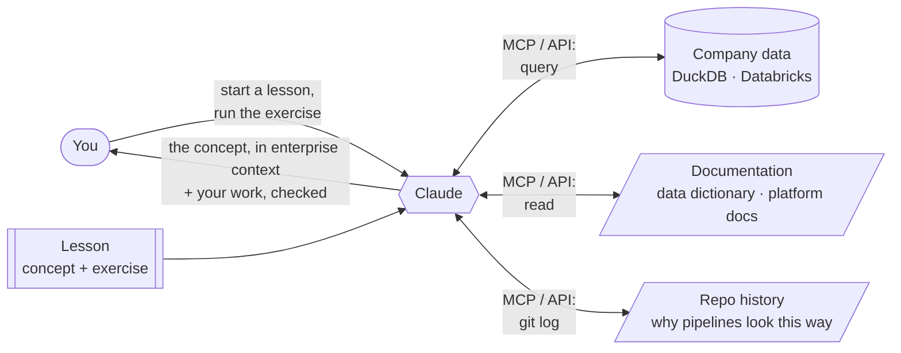

# knowledge-builder

**Learn a concept by working through it on real-shaped enterprise data, with AI giving you the full picture.**

knowledge-builder is a set of interactive learning modules, such as Databricks or claims data analytics. Each lesson
pairs a concept with the data of a fictional company, Halcyon Health, which runs a synthetic multi-payer healthcare
dataset.

You don't just read about a concept. Claude teaches it in context, pulling from the same sources an engineer would
use on the job, through **MCP servers and API connections**:

- **The data:** it queries the actual tables, so every idea is shown in rows you can inspect
- **The documentation:** the data dictionary, platform docs and reference material
- **The repo history:** git commits and changes, to explain *why* the data and pipelines look the way they do

You run the exercises yourself. Claude explains, connects the concept to the enterprise context, and checks your work.

**Modules:** [`databricks-intro`](modules/databricks-intro/) · [`claims-data-analytics`](modules/claims-data-analytics/).
Details are in [CLAUDE.md](CLAUDE.md).
