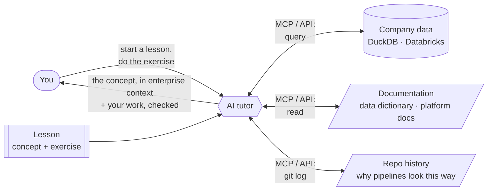
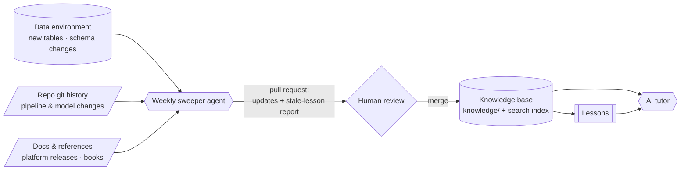

# knowledge-builder

**Learn a concept by working through it on real-shaped enterprise data, with AI giving you the full picture.**

knowledge-builder is a set of interactive learning modules, such as Databricks or claims data analytics, for
engineers, analysts, operations and business teams. Each lesson pairs a concept with the data of a fictional company,
Halcyon Health, which runs a synthetic multi-payer healthcare dataset.

You don't just read about a concept. An **AI tutor** teaches it in context, pulling from the same sources a colleague
would use on the job, through **MCP servers and API connections**:

- **The data:** it queries the actual tables, so every idea is shown in rows you can inspect
- **The documentation:** the data dictionary, platform docs and reference material
- **The repo history:** git commits and changes, to explain *why* the data and pipelines look the way they do

You do the work. The tutor explains, connects the concept to the enterprise context, and checks your work.

## Knowledge that stays current

A **weekly sweeper agent** scans what changed (the data, the docs, the code history and the reference material) and
proposes updates to a shared **knowledge base**. Lessons draw on the knowledge base instead of hard-coding facts, so
every lesson teaches with the latest context. A person reviews and merges every change.

## Who it's for and how it runs

- **For every role.** **Hands-on** learners run the SQL and CLI themselves. **Guided** learners ask questions in plain
  language; the tutor runs read-only queries and walks through the results. No code is required.
- **Any interface.** It runs today in [Claude Code](https://claude.com/claude-code). A web or chat UI can sit in front
  of it with the same lessons and the same connections.
- **Not just any AI.** The tutor is model-agnostic and works with any capable model that supports tools and MCP. With
  **real enterprise data, especially PHI**, use only an organization-approved model under a **Business Associate
  Agreement (BAA)**, such as Claude on a HIPAA-eligible deployment, with approved connectors only. This public repo
  uses **synthetic data only**, so no PHI is involved.

**Modules:** [`databricks-intro`](modules/databricks-intro/) · [`claims-data-analytics`](modules/claims-data-analytics/).
Details are in [CLAUDE.md](CLAUDE.md).

## Propose a module or lesson

Anyone can suggest what to learn next:

- **[Propose a module](https://github.com/filustre23/knowledge-builder/issues/new?template=propose-module.yml):** a new topic
- **[Propose a lesson](https://github.com/filustre23/knowledge-builder/issues/new?template=propose-lesson.yml):** a new lesson, or a change to an existing one

See [CONTRIBUTING.md](CONTRIBUTING.md) for how proposals become lessons.
